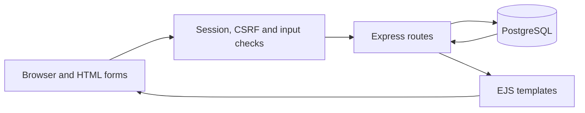
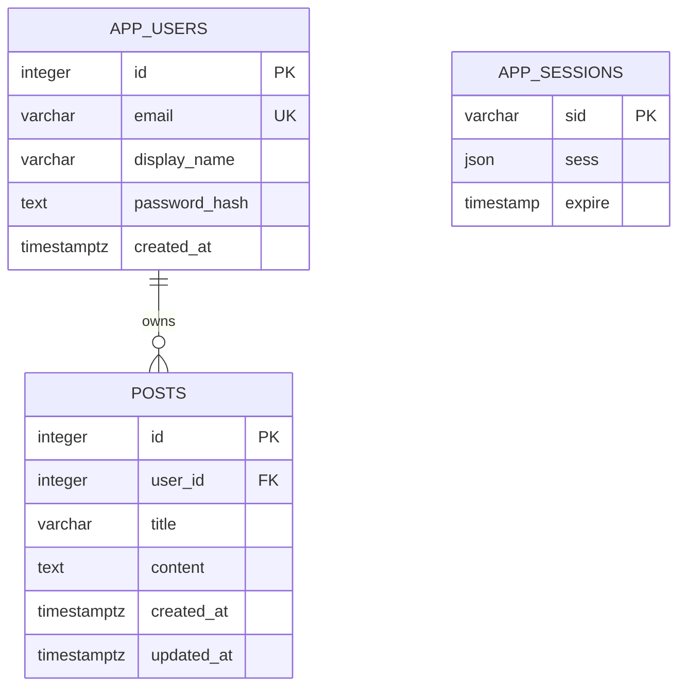

# Architecture

Neon Notes is a server-rendered Express application. EJS creates the HTML; standard HTML forms submit to the server; PostgreSQL owns persistent account, post and session data.

## Request flow



## Design decisions

| Decision | Reason | Trade-off |
| --- | --- | --- |
| EJS and HTML forms | Fits a focused writing application with server-rendered pages | Most interactions reload the page |
| PostgreSQL | Keeps posts across process restarts and enforces relationships | Requires a database service and backups |
| Database-backed sessions | Sessions remain valid across app restarts | Requests depend on database availability |
| User ownership in SQL | A requested post ID must also match the signed-in user's ID | Shared or public posts need explicit new access rules |
| Node.js scrypt | Salted password hashing using the platform's crypto API | Deliberately expensive password checks require throttling |
| Separate app and server modules | Tests can instantiate the app without starting the production listener | Startup and route code live in separate files |

## Data model



Session JSON contains the user ID after authentication. It is not a relational foreign key; the middleware looks up the account and treats missing users as signed out. Passwords are hashed, but post content is not end-to-end encrypted.

## Project structure

```text
neon-notes/
├── .github/workflows/test.yml  # Automated integration checks
├── database/
│   └── schema.sql             # Account, post and session tables
├── docs/
│   ├── deployment.md          # Render setup and hosting lifecycle
│   └── security.md            # Protections and current limitations
├── public/
│   └── styles.css             # Shared responsive neon theme
├── scripts/
│   └── migrate.js             # Standalone database initialisation
├── src/
│   ├── app.js                 # Middleware, authentication and post routes
│   ├── server.js              # Startup, configuration and shutdown
│   └── lib/
│       ├── database.js        # Connection pool and schema initialisation
│       └── passwords.js       # Password hashing and verification
├── tests/
│   └── app.test.js            # Database-backed integration tests
├── views/
│   ├── partials/nav.ejs       # Shared account navigation
│   ├── auth.ejs               # Registration and sign-in
│   ├── edit.ejs               # Post editor
│   ├── error.ejs              # Friendly error screen
│   └── index.ejs              # Landing page and private workspace
├── .env.example               # Safe configuration template
├── .gitignore                 # Excludes secrets and generated files
├── package.json               # Dependencies and project commands
├── package-lock.json          # Exact dependency versions
├── render.yaml                # Optional separate Render preview setup
└── README.md
```

## Routes

| Method | Path | Behaviour |
| --- | --- | --- |
| GET | `/` | Landing page for guests; own posts for signed-in users |
| GET / POST | `/register` | Display registration or create an account |
| GET / POST | `/login` | Display login or authenticate |
| POST | `/logout` | Destroy the current session |
| POST | `/posts` | Create an owned post |
| GET / POST | `/posts/:id/edit` | Display the editor or update an owned post |
| POST | `/posts/:id/delete` | Delete an owned post |
| GET | `/health` | Confirm database connectivity |

Forms that change state require a valid CSRF token. Post routes also require authentication. Owner-scoped lookups return 404 for absent or inaccessible posts.

## Repository conventions

Configuration files remain at the repository root so Git, npm and hosting tools can find them. `src/`, `tests/`, `database/`, `views/`, `public/` and `docs/` separate distinct responsibilities. `.gitignore` is tracked; local `.env` files and installed `node_modules` are not. `.env.example` is a public template with placeholders.

## Reference projects reviewed

- [Express](https://github.com/expressjs/express): a short introduction, table of contents, quick start and test instructions.
- [Node Express Boilerplate](https://github.com/hagopj13/node-express-boilerplate): source/test separation, environment template and documented project structure.
- [RealWorld Express example](https://github.com/gothinkster/node-express-realworld-example-app): explicit prerequisites, environment configuration and database setup.

These informed documentation and organisational conventions. They use different stacks and scopes; their full architectures are not requirements for Neon Notes. The README describes this repository's actual implementation.

[Back to project overview](../README.md)
